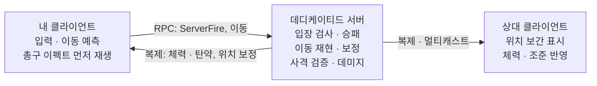
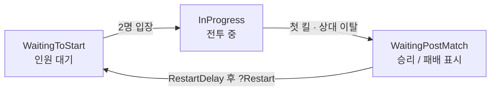
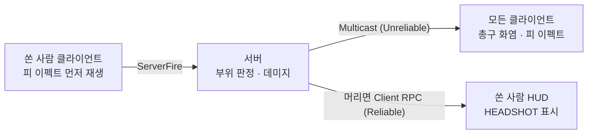

# DedicateTPS

Unreal Engine 5.8(소스 빌드) 기반의 **데디케이티드 서버 1:1 TPS**입니다.
모든 판정은 서버가 하고, 클라이언트는 입력·연출·예측만 담당하는 서버 권한 구조로 만들었습니다.
구현은 AI 에이전트(Claude Code)로 진행했고, 설계 결정·서버 검증 정책·실접속 테스트는 직접 했습니다.

> 플레이 영상: [YouTube](https://youtu.be/WKpO8-oPqxM)
>
> [](https://youtu.be/WKpO8-oPqxM)

## 게임 규칙

- 두 명이 접속하면 경기가 시작됩니다. 중간 입장은 막혀 있습니다.
- 먼저 상대를 처치한 쪽이 승리합니다. 경기 중 리스폰은 없습니다.
- 상대가 나가거나 맵 밖으로 떨어져도 남은 쪽이 승리합니다.
- 경기가 끝나면 5초 뒤 맵을 다시 불러와 새 경기를 시작합니다.

## 구조



매치 흐름은 서버 `GameMode`만 관리합니다.



| 폴더 | 내용 |
|---|---|
| `Source/DedicateTPS/Game` | GameMode(매치 수명주기, 입장 검사, 스폰), GameState(승자 복제), PlayerState, GameInstance(접속 실패 처리) |
| `Source/DedicateTPS/Player` | 캐릭터(사격·조준·재장전·체력·부위 데미지·피 이펙트), 커스텀 이동 컴포넌트(스프린트 예측), 애님 인스턴스 |
| `Source/DedicateTPS/Weapon` | 무기 연출, 탄약 컴포넌트 |
| `Source/DedicateTPS/UI` | 접속 화면, HUD(헤드샷 표시 포함), 경기 상태 위젯 |

## 네트워크에서 신경 쓴 부분

**사격은 서버가 판정합니다.**
클라이언트는 총구 이펙트를 먼저 보여주고 `ServerFire`로 요청만 보냅니다. 서버가 검증, 트레이스, 데미지를 처리한 뒤 다른 클라이언트에 연출을 멀티캐스트합니다.

**서버는 클라이언트 요청을 그대로 믿지 않습니다.**

| 검증 | 막는 것 |
|---|---|
| 사망·조준·재장전 상태 | 조건이 안 되는 사격 |
| 연사 속도(평균 속도 + 여유 시간) | 연사 핵. RPC가 한 틱에 몰려 도착해도 정상 사격은 거부하지 않음 |
| 트레이스 시작점 거리 | 시작점을 조작해 벽 너머나 상대 앞에서 쏘기 |
| 총구 → 탄착점 2차 트레이스 | 카메라로는 보이지만 총구가 막힌 코너 피킹 |
| 탄약 차감은 서버에서만 | 무한 탄약 |

**맞은 부위에 따라 데미지가 다릅니다.**
머리는 ×5(한 발에 처치), 몸통은 ×1, 팔다리는 ×0.5입니다. 피격 판정은 캡슐로 하고, 부위는 서버가 총알 경로와 본 위치를 비교해 정합니다. 연출은 받는 쪽을 나눴습니다.



**스프린트는 이동 예측에 포함했습니다.**
RPC로 처리하면 서버가 이동을 다른 속도로 재현해 위치 보정(러버밴딩)이 생깁니다. 그래서 `CharacterMovementComponent`의 SavedMove 플래그로 이동 데이터와 함께 보냅니다.

**입장은 두 번 검사합니다.**
`PreLogin`을 통과하고 맵을 로딩하는 동안에는 `NumPlayers`에 잡히지 않아서, 동시에 들어오면 인원을 초과할 수 있습니다. 실제 입장 시점인 `Login`에서 같은 함수로 한 번 더 검사합니다.

**데디 서버에서만 생기는 문제를 처리했습니다.**
- 데디 서버에서는 애니메이션 노티파이가 제때 오지 않아서, 재장전 탄약 보충 시점을 몽타주 에셋에서 읽어 타이머로 처리합니다.
- 총구 기준 판정을 위해 서버에서도 메시 본을 갱신합니다.

**알고 둔 한계**
- 지연 보상(서버 되감기)은 없습니다. 2인 게임이라 비용 대비 이득이 작다고 판단해 보류했습니다.
- 재시작은 non-seamless 트래블이라 경기 간에 상태(라운드 점수 등)가 유지되지 않습니다.
- PhysicsAsset 기반 메시 판정이 아니라 캡슐 + 본 위치 근사라서, 데디 서버가 몽타주를 재생하지 않는 만큼 부위 경계에서 클라이언트 화면과 판정이 갈릴 수 있습니다.

## AI 활용 방식

구현은 Claude Code로 했고, 다음 방식으로 AI 작업을 관리했습니다.

- **규칙 문서([`CLAUDE.md`](CLAUDE.md))**: 엔진 API는 기억이 아니라 엔진 소스에서 시그니처를 확인하게 하고, 빌드·테스트 명령, 코드 스타일, 과거에 겪은 함정을 기록했습니다.
- **설계 문서([`docs/combat.md`](docs/combat.md))와 알려진 이슈 목록([`docs/known-issues.md`](docs/known-issues.md))**: 전투 코드를 고치기 전에 설계 문서를 읽게 하고, 이미 판단을 마친 문제와 리뷰 오탐을 기록해 같은 지적이 반복되지 않게 했습니다.
- **작업 순서**: 구현 → AI 코드 리뷰 → 리뷰 항목을 직접 "고침 / 보류 / 오탐"으로 분류 → 수정 → 실접속 테스트 → 커밋
- **AI가 틀린 사례**: 리뷰가 "클라이언트에서 `FellOutOfWorld`가 폰을 숨긴다"고 지적했지만, 엔진 소스를 확인하니 권한이 있을 때만 동작하는 코드여서 오탐으로 분류했습니다. 맵의 BlockingVolume이 총알을 막던 문제는 코드 리뷰로는 찾지 못했고, 실제로 쏴 보고 발견해 콜리전 프로필로 해결했습니다.

## 실행 방법

> `Content`(맵, 블루프린트, 에셋)는 레포에 포함되어 있지 않아 이 레포만으로는 실행할 수 없습니다.

빌드 (에디터를 끈 상태에서):

```
<엔진 경로>\Engine\Build\BatchFiles\Build.bat DedicateTPSEditor Win64 DebugGame -Project=<프로젝트 경로>\DedicateTPS.uproject -WaitMutex -NoHotReload
```

서버 실행 (에디터 바이너리를 `-server`로 실행, 포트 7777):

```
RunServer.bat
```

클라이언트는 에디터에서 Standalone으로 실행하거나, 메인 메뉴에서 `127.0.0.1:7777`을 입력해 접속합니다.

## 개발 환경

- Unreal Engine 5.8 (소스 빌드)
- C++ / Blueprint
- Windows 11, Visual Studio
- Claude Code
